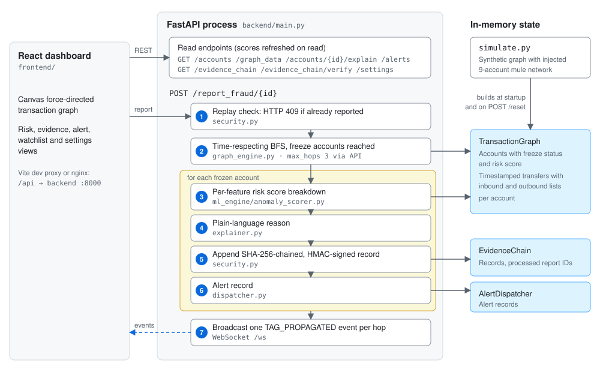

# TraceFlux - Cross-Bank Fraud Tracing Simulator

[](https://github.com/medwinjose/TraceFlux/actions/workflows/ci.yml) [](LICENSE) 

TraceFlux is a single-process simulator of a payment clearing switch that, on a fraud report, follows stolen funds forward only through transfers made after the money arrived and freezes every account it reached.

## The Problem

When money is stolen from a bank customer, it is often moved quickly through a chain of mule accounts held at different banks. Each bank sees only its own ledger, so no single institution can follow the funds past its own boundary. Tracing then depends on manual recall requests between banks while the money keeps moving.

A clearing switch that settles transfers between banks does see every hop. Freezing everything reachable from the reported account is not enough, though: a mule account can also have older, legitimate payments, and following those would freeze innocent counterparties.

## The Solution

TraceFlux models the switch as a timestamped transaction graph and acts on a fraud report in one pass:

- **Time-respecting trace.** A breadth-first search starts at the reported account and follows a transfer only if it happened at or after the moment tainted money reached the sending account. A mule's earlier, unrelated payments are not followed. The filter does not apply to the reported account's own transfers: all of them are followed.
- **Freeze on contact.** Every account the trace reaches is marked frozen, up to a hop limit (`max_hops`, 3 by default through the API, adjustable through `POST /settings`).
- **Risk scores before any report.** Each account gets a score from five behavioural signals: fan-out ratio (weight 0.35), hold time before forwarding (0.30), reactivation after 30 or more days of inactivity (0.20), amounts just below reporting thresholds (0.10) and 24-hour transaction rate (0.05). Scores of 0.75 and above are `HIGH_RISK`, 0.45 and above `WATCH`. The weights are fixed by hand, not learned.
- **A written reason for every freeze.** `explainer.py` turns the trace position and the score breakdown into one or two plain-language sentences.
- **Tamper-evident record.** Each freeze is appended to a log in which every entry carries the SHA-256 hash of the previous entry and an HMAC-SHA256 signature. Changing any past entry breaks every later hash.
- **No double processing.** A second report for the same account returns HTTP 409 until the simulation is reset.

| Design decision | Instead of | Why |
|---|---|---|
| Time-respecting BFS from the reported account | Freezing every account reachable in the graph | Recipients of payments made before the stolen money arrived are not frozen |
| Fixed-weight linear score over five features | A trained model | Every score splits into per-feature contributions, served by `GET /accounts/{id}/explain` |
| SHA-256 hash chain with an HMAC-SHA256 signature per entry | A plain append-only list | Editing a past record changes every later hash |

## Architecture



One FastAPI process holds the whole graph in memory, with inbound and outbound transfer lists per account. `simulate.py` builds a synthetic graph of background accounts plus an injected mule network of 9 accounts (victim, 6 mules over three hops, 2 cash-out accounts). A React dashboard draws the graph on an HTML canvas and animates each freeze from WebSocket events.

A fraud report passes through these steps in `main.py`:

```
POST /report_fraud/{id} → replay check (409 if already reported) → time-respecting BFS (graph_engine.py)
  → per frozen account: risk score breakdown (anomaly_scorer.py) → plain-language reason (explainer.py)
  → hash-chained, HMAC-signed evidence record (security.py) → alert record (dispatcher.py)
  → WebSocket TAG_PROPAGATED event per hop → dashboard
```

## Results

Measured on a shared cloud VM (Intel Xeon 2.10 GHz, 4 vCPU, Linux, Python 3.13) with `backend/benchmark.py`: 5 runs, each timing 200 calls after 10 warm-up calls, on the synthetic graph with `max_hops` 5. Ranges are the lowest and highest per-run median.

| Condition | Result |
|---|---|
| Fraud report on the 49-account graph (159 transfers) | All 9 injected accounts frozen; median 3.16 to 5.58 µs per report (measured) |
| Fraud report on the 509-account graph (1,539 transfers) | All 9 injected accounts frozen; median 3.24 to 5.99 µs per report (measured) |
| Scoring every account, 49 and 509 accounts | Median 0.21 to 0.35 ms and 2.79 to 2.95 ms per pass (measured) |
| Checking the hash chain, 10 and 100 records | Median 41.35 to 42.73 µs and 412.62 to 441.84 µs (measured) |
| Same report through the API (`max_hops` 3) | 7 of 9 injected accounts frozen; the 2 cash-out accounts are beyond the hop limit (in-process API check, output only) |
| Earlier, unrelated transfer from a mule | Its recipient is not frozen; the later recipient is (tested) |
| Scoring on a 45-account graph, seed 42 | 5 of 5 injected accounts scored `WATCH` or `HIGH_RISK`; 40 of 40 background accounts scored `CLEAN` (tested) |

Latency on this shared VM varies between runs, and a single run can fall outside these ranges. The graph is synthetic and `simulate.py` is not seeded: account counts and transfer counts are fixed, bank assignment and background transfers are not. Raw output, setup and commands are in [docs/benchmarks.md](docs/benchmarks.md) and [docs/validation.md](docs/validation.md).

## Engineering

- **Structure:** Python backend (FastAPI, Pydantic, Uvicorn) in `backend/`; React 18 dashboard built with Vite and Tailwind CSS in `frontend/`; a copy of the backend in `frontend/api/` packaged as a Vercel serverless function.
- **Security:** HMAC-SHA256 signatures on freeze commands and evidence records, a SHA-256 hash chain over the evidence log, and per-account replay protection. The HMAC key comes from `TRACEFLUX_HMAC_KEY`, or is random per process when unset, so signatures do not survive a restart. `GET /evidence_chain/verify` checks the hash links, not the signatures. Known security gaps are listed in [SECURITY.md](SECURITY.md).
- **Interfaces:** REST endpoints for accounts, transfers, graph data, score explanations, fraud reports, settings, alerts, the evidence chain and its verification, and reset; OpenAPI docs at `/docs`; a WebSocket at `/ws` that streams freeze and reset events.
- **Verification:** engine tests in `backend/test_system.py` (time filter, scoring and explanations, full-chain freeze on the demo graph, unknown accounts, repeated reports and reset), a scorer validation in `backend/validation.py` that builds its graph with its own copy of the graph classes, and in-process API checks in `verify_live_stack.py`. Under pytest, 4 of 4 tests in `test_system.py` passed on 2026-11-07.
- **CI:** GitHub Actions on Ubuntu with Python 3.11 runs `test_system.py`, `validation.py` and `verify_live_stack.py` on every push and pull request to `main`. No linter or type checker is configured.

## Quick start

A hosted demo runs at [traceflux.vercel.app](https://traceflux.vercel.app), served from the `frontend/api/` copy of the backend.

To run it locally, install Python 3.11 or newer and Node.js 18 or newer.

```bash
git clone https://github.com/medwinjose/TraceFlux.git
cd TraceFlux
pip install -r backend/requirements.txt pytest
cd backend && python -m pytest test_system.py && python validation.py && cd ..
python verify_live_stack.py
```

Run the API (port 8000), then the dashboard (port 5173) in a second terminal:

```bash
cd backend && python -m uvicorn main:app --port 8000
```

```bash
cd frontend && npm install && npm run dev
```

Reproduce the latency results (compare with [docs/benchmarks.md](docs/benchmarks.md)):

```bash
python backend/benchmark.py
```

## Research status and roadmap

TraceFlux is a working prototype on synthetic data: the trace, the risk scores, the evidence log, the API and the dashboard run end to end, and the test and validation scripts pass in CI. Next, in order:

1. Check HMAC signatures in `GET /evidence_chain/verify`.
2. Seed `simulate.py` so every start produces the same graph.
3. Apply the time filter to the reported account's own outgoing transfers.

Out of scope: real bank data, streaming ingestion, authentication, TLS and persistence; all state is in memory and lost on restart, and the project is not for production use. Known security gaps are listed in [SECURITY.md](SECURITY.md).

## Repository layout

| Path | Contents |
|---|---|
| `backend/graph_engine.py` | In-memory transaction graph and time-respecting BFS |
| `backend/ml_engine/anomaly_scorer.py` | Five-feature risk score, classification and per-feature breakdown |
| `backend/security.py` | Hash-chained evidence log, HMAC signing, replay check |
| `backend/main.py` | FastAPI REST endpoints and WebSocket |
| `backend/simulate.py` | Synthetic graph with an injected mule network |
| `backend/explainer.py`, `backend/dispatcher.py` | Plain-language freeze reasons; in-memory alert records |
| `backend/test_system.py`, `backend/validation.py`, `backend/benchmark.py` | Engine tests, scorer validation, latency benchmark |
| `verify_live_stack.py` | In-process API checks |
| `frontend/` | React dashboard; `frontend/api/` holds the Vercel serverless copy of the backend |
| `docs/` | Benchmark setup and raw output, raw test output ([index](docs/README.md)) |

## License

MIT License. See [LICENSE](LICENSE).
