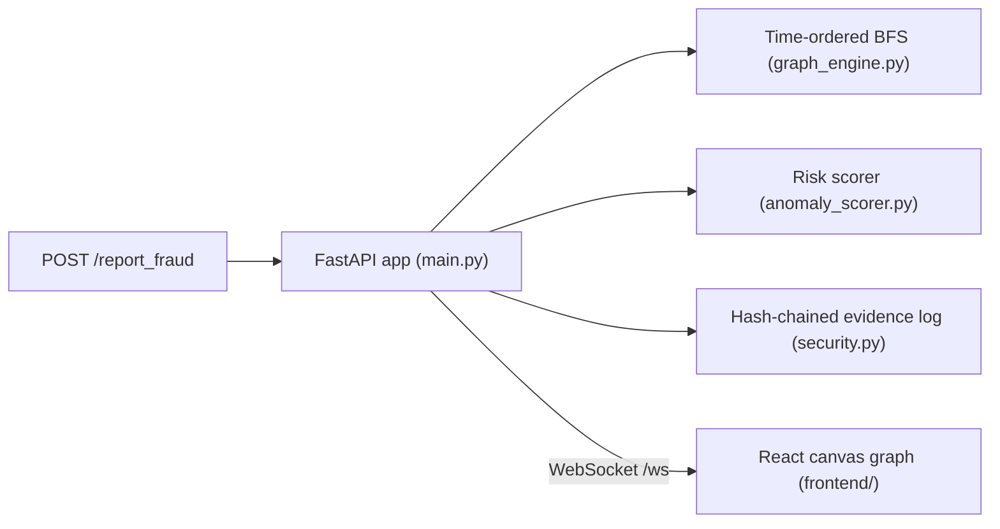

# TraceFlux - a single-node simulator that traces stolen funds across banks with a time-ordered graph search and freezes the accounts they reach

[](https://github.com/medwinjose/TraceFlux/actions/workflows/ci.yml)
[](LICENSE)


[Architecture](#architecture) | [Results](#key-results) | [Limitations](#limitations-and-scope) | [Quick start](#quick-start) | [Cite](#cite)

## At a glance

- **What:** A clearing-switch simulator. When one account is reported as defrauded, it follows the money forward through later transfers and freezes every account the money reached.
- **Why it matters:** Each bank sees only its own ledger, so stolen funds can pass through several mule accounts at different banks before anyone traces them.
- **Headline result:** On the 49-account synthetic graph, one fraud report freezes all 9 injected chain accounts in a median of 4.04 µs (Measured, 200 iterations, Python 3.13, Intel Xeon 2.10 GHz; `python backend/benchmark.py`).
- **Status:** Research prototype on synthetic data. Last verified 2026-11-07 at commit `1756b4b`.
- **Not in scope:** Real bank data or real-time ingestion; authentication or TLS on the API.
- **Author:** Medwin Jose, Student, VIT Bhopal University.

## Problem and approach

A fraud report names one account and a time. Funds that left that account then moved hop by hop through other accounts, often at other banks. The simulator keeps every transfer as a timestamped directed edge between accounts. On a report, a breadth-first search follows an account's outgoing transfers only if they happened at or after the time tainted money arrived there, so a mule's older, unrelated payments are not frozen. A separate scorer rates every account on five behavioural signals before any report exists. Every freeze is written to a hash-chained log with an HMAC signature per entry.

| Decision | Instead of | Why | Record |
| --- | --- | --- | --- |
| Time-respecting BFS from the reported account | Freezing every account reachable in the graph | Avoids freezing recipients of payments made before the money arrived | `test_timestamp_filtered_propagation` in `backend/test_system.py` |
| Fixed-weight linear score over 5 features | A trained model | Each score splits into per-feature contributions served by `/accounts/{id}/explain` | `backend/ml_engine/anomaly_scorer.py` |
| SHA-256 hash chain plus HMAC-SHA256 per entry | Plain append-only list | Editing any past record changes every later hash | `backend/security.py` |

## Architecture



One FastAPI process holds the whole graph in memory (`TransactionGraph`, with per-account inbound and outbound edge lists). `simulate.py` builds a synthetic graph of background accounts plus a 9-account injected mule network. On a report, `graph_engine.py` runs the BFS (default `max_hops` 3 through the API), `explainer.py` writes a plain-language reason for each freeze, and `security.py` appends one signed record per frozen account. The React frontend draws the graph on an HTML canvas and animates freezes from WebSocket events. The scorer weights are `fan_out_ratio` 0.35, `hold_time_inverse` 0.30, `dormant_reactivation` 0.20, `structuring_score` 0.10 and `velocity` 0.05; scores of 0.75 and above are `HIGH_RISK`, 0.45 and above `WATCH`.

## Key results

| Claim | Setup | Evidence type | Reproduce |
| --- | --- | --- | --- |
| A report freezes the downstream account but not the recipient of an earlier, unrelated transfer | 4-account hand-built graph | Test (CI) | `cd backend && python test_system.py` |
| BFS freeze latency: median 4.04 µs, p99 14.88 µs (49 nodes, 159 edges); median 4.23 µs, p99 17.88 µs (509 nodes, 1,539 edges) | 9 accounts frozen per run, `max_hops` 5; 200 iterations after 10 warm-ups; 1 benchmark run; Python 3.13, Intel Xeon 2.10 GHz, 4 vCPU, Linux | Measured | `python backend/benchmark.py` |
| Full-graph scoring: median 0.26 ms (49 nodes), 2.29 ms (509 nodes) | Same as above | Measured | `python backend/benchmark.py` |
| Hash-chain check: median 33.69 µs for 10 records, 345.11 µs for 100 | Same as above | Measured | `python backend/benchmark.py` |
| 5 of 5 injected chain accounts score `WATCH` or `HIGH_RISK`; 40 of 40 background accounts score `CLEAN` | Separate 45-account graph in `validation.py`, seed 42 | Simulation | `cd backend && python validation.py` |

Latency figures are one run on one machine and vary across hardware.

## Verification and assurance

- Tests: `backend/test_system.py` has 4 test functions; 4 passed under pytest on 2026-11-07 (`cd backend && python -m pytest test_system.py`).
- CI (GitHub Actions, Ubuntu, Python 3.11) runs `test_system.py`, `validation.py` and `verify_live_stack.py` on every push and pull request to `main`. The run for commit `1756b4b` passed.
- `verify_live_stack.py` calls the API in-process: `/graph_data`, `/accounts/MULE1/explain`, `/report_fraud/VICTIM` and `/alerts`.
- No linter, type checker or coverage tool is configured.
- Security notes: [SECURITY.md](SECURITY.md).

## Limitations and scope

- Synthetic data only. `simulate.py` is not seeded, so bank assignment and background edges change on each start; node and edge counts do not.
- Through the API, `max_hops` defaults to 3, so a report at `VICTIM` freezes 7 of the 9 chain accounts; the two cash-out accounts are not reached. The tests and benchmark use the engine default of 5, which freezes all 9.
- The time filter starts at the first hop: all outgoing transfers of the reported account are followed, whatever their time.
- Scorer weights and thresholds are set by hand for the demo graph. They are not fitted or tested on real fraud data.
- `validation.py` scores a graph built by its own copy of the graph classes, not by `graph_engine.py`.
- `GET /evidence_chain/verify` checks the hash links only; it does not check the HMAC signatures.
- The HMAC key is random per process unless `TRACEFLUX_HMAC_KEY` is set, so signatures do not survive a restart.
- No authentication, TLS or persistence. All state is in memory and lost on restart. Not for production use.

## Quick start

Prerequisites: Python 3.11 or newer, Node.js 18 or newer.

```bash
git clone https://github.com/medwinjose/TraceFlux.git && cd TraceFlux
pip install -r backend/requirements.txt
cd backend && python test_system.py && python validation.py && cd .. && python verify_live_stack.py
```

Run the API (port 8000, OpenAPI docs at `/docs`) and, in a second terminal, the dashboard (port 5173):

```bash
cd backend && python -m uvicorn main:app --port 8000
```

```bash
cd frontend && npm install && npm run dev
```

Reproduce the latency table with `python backend/benchmark.py`.

## Repository layout

| Path | Contents |
| --- | --- |
| `backend/graph_engine.py` | In-memory transaction graph and time-ordered BFS |
| `backend/ml_engine/anomaly_scorer.py` | Five-feature risk score, classification and per-feature breakdown |
| `backend/security.py` | Hash-chained evidence log, HMAC signing, replay check |
| `backend/main.py` | FastAPI REST endpoints and WebSocket hub |
| `backend/simulate.py` | Synthetic graph with an injected mule network |
| `backend/explainer.py`, `backend/dispatcher.py` | Plain-language freeze reasons; alert records |
| `backend/test_system.py`, `backend/validation.py` | Engine tests; scorer validation |
| `backend/benchmark.py` | Latency benchmark |
| `verify_live_stack.py` | In-process API checks |
| `frontend/src/` | React dashboard with canvas graph view |
| `frontend/api/` | Copy of the backend packaged as a Vercel serverless function |
| `.github/workflows/ci.yml` | CI workflow |

## Roadmap

- Check HMAC signatures in `GET /evidence_chain/verify`.
- Seed `simulate.py` so every start produces the same graph.
- Apply the time filter to the reported account's own outgoing transfers.

## Contributing and security

Report bugs through [GitHub Issues](https://github.com/medwinjose/TraceFlux/issues). Known security gaps and reporting guidance are in [SECURITY.md](SECURITY.md).

## Cite

No DOI or CITATION.cff exists yet. Cite the repository URL and the commit hash used.

## Author and contact

Medwin Jose, Student, VIT Bhopal University. GitHub: [medwinjose](https://github.com/medwinjose).

## License

MIT; see [LICENSE](LICENSE).
