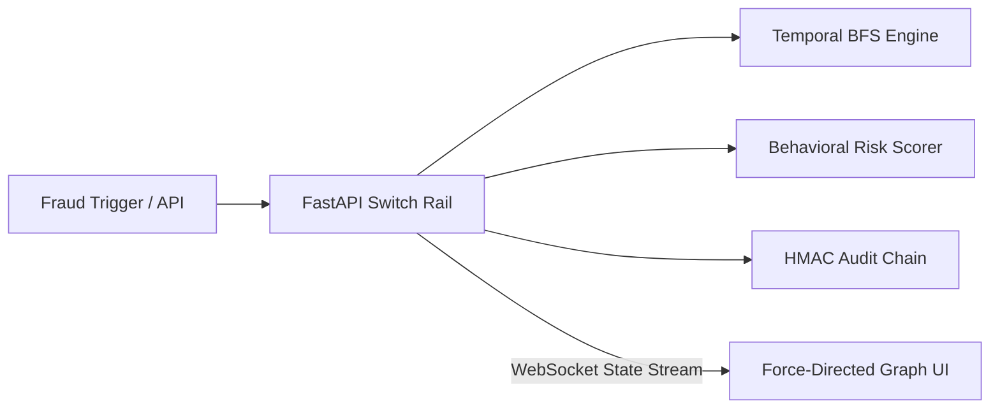

# TraceFlux

**Temporal Graph Interdiction & Cross-Institutional Taint Propagation Simulator**

[](https://github.com/medwinjose/TraceFlux/actions/workflows/ci.yml)
[](https://traceflux.vercel.app/)


TraceFlux is an architectural simulation of a central-switch payment interdiction rail. It models how a payment clearinghouse can execute **causal, time-bounded taint propagation** and **continuous behavioral risk scoring** across institutional boundaries to halt multi-hop mule networks in real time, backed by a tamper-evident cryptographic audit log.

---

## 1. Problem Formulation

In cross-institutional payment networks, fraudulent transfers (such as Authorized Push Payment fraud or account takeovers) are rapidly layered across intermediary "mule" accounts at distinct banks. Because individual institutions only observe local ledger state, downstream tracing typically relies on manual inter-bank recalls while funds continue to disperse.

TraceFlux models the clearing switch as an active interdiction layer over a **temporal directed multigraph** $G = (V, E)$, where vertices $V$ represent accounts across institutions and directed edges $e = (u, v, t, a) \in E$ represent settled transfers of amount $a$ at timestamp $t$.

The system enforces two complementary mechanisms:
1. **Reactive Causal Interdiction (`graph_engine.py`):** Given a fraud report on an origin account $v_0$ with initial compromise timestamp $t_0$, the rail executes a time-respecting Breadth-First Search (BFS) that traverses and freezes downstream accounts $v_k$ if and only if every edge in the path satisfies causal ordering ($t(e_i) \ge t_0$). This prevents retroactive false freezes on a counterparty's prior legitimate transactions.
2. **Proactive Behavioral Scoring (`ml_engine/anomaly_scorer.py`):** Continuously evaluates all vertices $v \in V$ over a 5-dimensional behavioral feature vector in $O(\text{deg}(v))$ time to flag dormant-reactivated or high-velocity pass-through conduits prior to an explicit upstream fraud report.

---

## 2. System Architecture



### Core Subsystems

* **Temporal Graph Engine (`backend/graph_engine.py`):** Maintains indexed in-memory adjacency structures (`outgoing`, `incoming`, and monotonic latest timestamp tracking) and executes timestamp-bounded BFS traversal ($O(\vert{}V\vert{} + \vert{}E\vert{})$ worst-case complexity). Guarantees idempotency under duplicate upstream reports and strict causal isolation (`tx.timestamp >= earliest_ts`).
* **Behavioral Anomaly Scorer & Explainer (`backend/ml_engine/anomaly_scorer.py`, `backend/explainer.py`):** Evaluates local graph-topological and temporal features per account in $O(\text{deg}(v))$ time via indexed adjacency lists, computing a normalized risk score alongside decomposed feature weights that translate directly into human-readable compliance rationales.
* **Tamper-Evident Audit Chain (`backend/security.py`):** Records every state transition (account freeze) in a hash-linked log. For record $k$, the event payload dictionary:
  $$\text{payload}_k = \{\text{account\_id}, \text{bank\_id}, \text{event\_type}, \text{metadata}, \text{reason\_plain}, \text{timestamp}\}$$
  is canonically serialized ($m_k = \text{canonical\_json}(\text{payload}_k)$) and hash-chained from genesis $H_0 = 0^{64}$:
  $$H_k = \text{SHA-256}(H_{k-1} \parallel m_k)$$
  Each entry carries an institutional authenticity signature $\sigma_k = \text{HMAC-SHA256}_K(m_k)$. Outgoing freeze dispatches to member banks carry a corresponding command signature $\sigma_{\text{freeze}} = \text{HMAC-SHA256}_K(\text{canonical\_json}(\{\text{account\_id}, \text{bank\_id}, \text{frozen\_chain}\}))$. Chain integrity is independently verifiable via `GET /evidence_chain/verify`.
* **Interactive Telemetry Console (`frontend/`):** React + HTML5 Canvas force-directed graph visualizer connected via WebSockets (`WS /ws`), supporting real-time topology scaling from a 49-node baseline (40 normal accounts + 9-node laundering chain) up to 500+ synthetic stress-test nodes.

### Empirical Performance (Local Single-Node)

Benchmarked on a local runtime (Python 3.11, Intel/AMD multi-core) across 200 iterations with 10 warmup runs and explicit garbage-collection pinning via `backend/benchmark.py`. With indexed vertex-adjacency structures, full-graph feature evaluation scales strictly linearly ($O(\vert{}V\vert{} + \vert{}E\vert{})$) rather than unindexed global scans ($O(\vert{}V\vert{} \cdot \vert{}E\vert{})$):

| Operation | Workload / Topology | Algorithmic Complexity | Median ($p_{50}$) | Tail Latency ($p_{99}$) |
| :--- | :--- | :--- | :--- | :--- |
| **Causal BFS Traversal** | Baseline graph (49 nodes, 159 edges) | $O(\vert{}V\vert{} + \vert{}E\vert{})$ | **3.60 µs** | 14.80 µs |
| **Causal BFS Traversal** | Stress graph (509 nodes, 1,539 edges) | $O(\vert{}V\vert{} + \vert{}E\vert{})$ | **3.80 µs** | 8.80 µs |
| **Behavioral Scoring** | Single account evaluation | $O(\text{deg}(v))$ | **5.80 µs** | 13.90 µs |
| **Full-Graph Scoring Pass** | Baseline graph (49 nodes) | $O(\vert{}V\vert{} + \vert{}E\vert{})$ | **0.29 ms** | 0.83 ms |
| **Full-Graph Scoring Pass** | Stress graph (509 nodes) | $O(\vert{}V\vert{} + \vert{}E\vert{})$ | **2.97 ms** | 4.43 ms |
| **HMAC Log Append** | Single audit entry (`append`) | $O(1)$ | **7.00 µs** | 45.70 µs |
| **Audit Log Verification** | 10-record hash chain (`verify_chain`) | $O(N)$ | **50.90 µs** | 197.50 µs |
| **Audit Log Verification** | 100-record hash chain (`verify_chain`) | $O(N)$ | **431.25 µs** | 871.50 µs |

> When expanding the topology by $10.4\times$ (49 $\to$ 509 nodes), full-graph scoring latency scales by $10.2\times$ ($0.29\text{ ms} \to 2.97\text{ ms}$), demonstrating optimal $O(\vert{}V\vert{} + \vert{}E\vert{})$ linear empirical scaling.

---

## 3. Behavioral Feature Specification

Each account vertex $v \in V$ is evaluated over five laundering indicators extracted from local graph adjacency and temporal event history:

1. **Fan-Out Dispersion Ratio ($x_1 \in [0, 1]$):**
   $$x_1 = \frac{\vert{}\{ u \in V \mid \exists e = (v, u) \in E \}\vert{}}{\max(1, \vert{}\{ e \in E \mid \text{src}(e) = v \}\vert{})}$$
   Measures dispersion of funds across distinct downstream counterparties relative to total outbound transfers.
2. **Normalized Transaction Velocity ($\tilde{x}_2 \in [0, 1]$):**
   Let $N_{\Delta}(v)$ be the count of transactions incident to $v$ in the trailing 24 hours. Transaction rate $v_{\text{rate}} = \frac{N_{\Delta}(v)}{24}\ \text{tx/hr}$ is capped at 10 tx/hr:
   $$\tilde{x}_2 = \min\left(\frac{v_{\text{rate}}}{10.0}, 1.0\right)$$
3. **Dormant Reactivation Indicator ($x_3 \in \{0, 1\}$):**
   Binary indicator flagging accounts inactive for $\ge 30\text{ days}$ prior to an abrupt transaction burst:
   $$x_3 = \begin{cases} 1 & \text{if } \exists k \text{ s.t. } t_k - t_{k-1} \ge 30 \times 86400\text{ s} \\ 0 & \text{otherwise} \end{cases}$$
4. **Regulatory Structuring Score ($x_4 \in [0, 1]$):**
   Proportion of transactions clustering in the band $[0.9 \cdot T, T)$ immediately below regulatory cash transaction reporting thresholds $\mathcal{T} = \{10\text{k}, 50\text{k}, 100\text{k}, 200\text{k}, 500\text{k}, 1\text{M}\}$:
   $$x_4 = \frac{\vert{}\{ e \in E(v) \mid \exists T \in \mathcal{T} \text{ s.t. } 0.9 \cdot T \le a(e) < T \}\vert{}}{\max(1, \vert{}E(v)\vert{})}$$
5. **Inverse Residence / Hold Time ($\tilde{x}_5 \in (0, 1]$):**
   Given mean residence duration $\bar{t}_{\text{hold}}$ (in minutes) between fund arrival and forward transfer:
   $$\tilde{x}_5 = \frac{1}{1 + \bar{t}_{\text{hold}}}$$

### Composite Risk Formulation & Classification

The composite behavioral score $S(v)$ is computed as the bounded affine combination:
$$S(v) = \min\left(1.0, \sum_{i=1}^5 w_i \cdot \tilde{x}_i \right)$$
$$\text{where } \mathbf{w} = [0.35, 0.05, 0.20, 0.10, 0.30]^\top, \quad \sum_{i=1}^5 w_i = 1.00$$

Classification follows strict decision boundaries:
$$\text{Class}(v) = \begin{cases} \text{HIGH\_RISK} & \text{if } S(v) \ge 0.75 \\ \text{WATCH} & \text{if } 0.45 \le S(v) < 0.75 \\ \text{CLEAN} & \text{if } S(v) < 0.45 \end{cases}$$

| Feature | Weight ($w_i$) | Normalized Input | Target Typology |
| :--- | :--- | :--- | :--- |
| `fan_out_ratio` | **0.35** | $x_1 \in [0, 1]$ | **Layering / Dispersion:** Aggregating illicit funds and rapidly splitting to multiple downstream accounts. |
| `velocity` | **0.05** | $\tilde{x}_2 = \min(v_{\text{rate}} / 10, 1)$ | **Burst Laundering:** Sudden acceleration in transfer volume over rolling 24-hour windows. |
| `dormant_reactivation` | **0.20** | $x_3 \in \{0, 1\}$ | **Aged Mule Accounts:** Seasoned accounts left dormant to clear onboarding filters before sudden utilization. |
| `structuring_score` | **0.10** | $x_4 \in [0, 1]$ | **Smurfing / Structuring:** Deliberately calibrating transfers immediately below mandatory reporting thresholds. |
| `hold_time_inverse` | **0.30** | $\tilde{x}_5 = 1 / (1 + \bar{t}_{\text{hold}})$ | **Pass-Through Conduits:** Automated forwarders exhibiting near-zero balance holding duration. |

Querying `GET /accounts/{id}/explain` returns the decomposed attribution $\{w_i \cdot \tilde{x}_i\}$, which `backend/explainer.py` maps to natural-language compliance receipts.

---

## 4. Scope & Production Mapping

TraceFlux is a deterministic single-node simulation designed for zero-dependency local verification. The table below maps the prototype's in-process components to their production equivalents in a distributed clearing switch:

| Subsystem | Prototype Implementation | Distributed Production Equivalent |
| :--- | :--- | :--- |
| **Graph Store** | In-memory `TransactionGraph` (`graph_engine.py`) | Partitioned distributed graph engine (Memgraph / Neo4j) with hot in-memory adjacency cache |
| **Ingestion & Routing** | Single-process FastAPI event loop (`main.py`) | Partitioned event streaming backbone (Apache Kafka / Redpanda) feeding stateless worker pools |
| **Evidence Log** | Local in-process HMAC hash chain (`security.py`) | Append-only WORM log or permissioned consortium ledger with HSM-backed signing |
| **Transaction Stream** | Deterministic topology generator (`simulate.py`) | Low-latency ISO 20022 event ingestion from participating core banking switches |
| **Client Telemetry** | Single-process WebSocket hub (`WS /ws`) | Multi-tenant pub/sub gateway (Redis Streams / Kafka) with mTLS institutional scoping |

---

## 5. Repository Structure

```text
TraceFlux/
├── .github/
│   └── workflows/
│       └── ci.yml                   # GitHub Actions automated verification pipeline
├── docker-compose.yml               # Multi-container orchestration (FastAPI + production UI)
├── verify_live_stack.py             # End-to-end in-process pipeline verification script
├── backend/
│   ├── main.py                      # FastAPI application, REST endpoints, & WebSocket hub
│   ├── graph_engine.py              # Temporal TransactionGraph & causal BFS propagation
│   ├── security.py                  # HMAC-SHA256 hash chain construction & verification
│   ├── explainer.py                 # Feature-weight attribution to natural-language rationale
│   ├── dispatcher.py                # Real-time FreezeAlert serialization & broadcast
│   ├── simulate.py                  # Synthetic network topology generator
│   ├── benchmark.py                 # Micro-benchmark harness for latency evaluation
│   ├── test_system.py               # Automated test suite (causality, idempotency, graph logic)
│   ├── validation.py                # Feature extraction & scoring boundary verification
│   └── ml_engine/
│       └── anomaly_scorer.py        # Multi-signal behavioral risk scoring engine
└── frontend/
    └── src/
        ├── App.jsx                  # WebSocket state synchronization & view router
        └── components/
            ├── NetworkGraph.jsx     # HTML5 Canvas force-directed physics graph
            ├── RiskPanel.jsx        # Account inspector & feature-weight attribution view
            ├── AlertFeed.jsx        # Real-time WebSocket interdiction stream
            └── EvidenceView.jsx     # Cryptographic hash-chain audit explorer
```

---

## 6. API Specification

| Method | Endpoint | Description |
| :--- | :--- | :--- |
| `POST` | `/report_fraud/{account_id}` | Initiates causal BFS taint propagation from `{account_id}`, freezes downstream vertices, appends HMAC audit entries, and broadcasts state deltas. Idempotent on duplicate calls; returns `404` on unknown IDs; returns `409` on duplicate report IDs. |
| `GET` | `/accounts` | Returns all graph vertices with current state (`ACTIVE` / `FROZEN`) and behavioral risk scores. |
| `GET` | `/accounts/{id}/explain` | Returns decomposed feature weights and natural-language rationale for a specific account. |
| `GET` | `/graph_data` | Returns node and edge adjacency payload for force-directed canvas rendering. |
| `GET` | `/alerts` | Returns recent structured freeze alerts from the dispatcher. |
| `GET` | `/evidence_chain` | Returns the complete HMAC-signed audit log of all interdiction events. |
| `GET` | `/evidence_chain/verify` | Recomputes and validates every cryptographic link in the evidence chain. |
| `POST` | `/reset` | Resets graph topology, vertex states, and audit log to initial baseline. |
| `WS` | `/ws` | Streams real-time `TAG_PROPAGATED`, `ACCOUNT_FROZEN`, and `DEMO_RESET` events. |

---

## 7. Local Execution & Verification

### Docker (Recommended)
```bash
docker compose up --build
```
* **Telemetry Console:** `http://localhost:5173`
* **OpenAPI Specification:** `http://localhost:8000/docs`

### Manual Execution & Verification Suites
```bash
# 1. Install backend dependencies
pip install -r backend/requirements.txt

# 2. Execute verification suites & empirical benchmarks
python backend/test_system.py
python backend/validation.py
python verify_live_stack.py
python backend/benchmark.py

# 3. Start backend service
python backend/run_demo.py

# 4. Start frontend (in a separate terminal)
cd frontend && npm install && npm run build && npm run preview
```

---

## 8. Security & License

All signing keys, account identifiers, and transaction topologies in this repository are synthetic and intended solely for architectural simulation. See [SECURITY.md](SECURITY.md) for threat-model scope. Licensed under the [MIT License](LICENSE).
