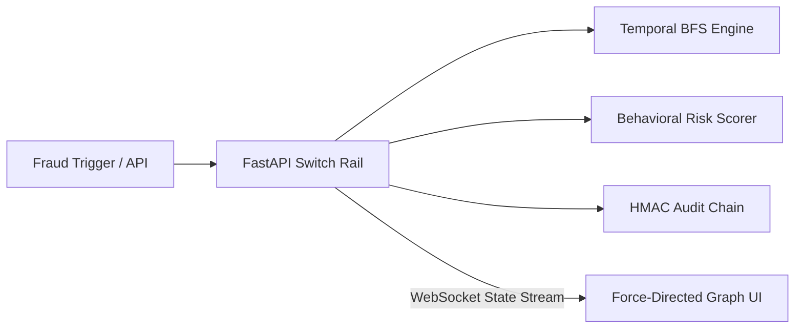

# TraceFlux

**Temporal Graph Interdiction & Cross-Institutional Taint Propagation Simulator**

[](https://github.com/medwinjose/TraceFlux/actions/workflows/ci.yml)
[](https://traceflux.vercel.app/)


TraceFlux is an architectural simulation of a central-switch payment interdiction rail. It models how a clearinghouse can execute **causal, time-bounded taint propagation** and **proactive behavioral risk scoring** across institutional boundaries to halt multi-hop mule networks in real time, backed by a tamper-evident audit log.

---

## 1. Problem Formulation

In cross-institutional payment networks, illicit transfers rapidly fan out across intermediary mule accounts at distinct banks. Because individual institutions only observe local ledgers, downstream tracing traditionally relies on manual inter-bank recalls while funds disperse.

TraceFlux models the clearing switch over a **temporal directed multigraph** $G = (V, E)$ with settled transfers $e = (u, v, t, a) \in E$. The system couples two interdiction primitives:
1. **Reactive Causal Interdiction (`graph_engine.py`):** On an upstream fraud report $(v_0, t_0)$, executes a time-respecting Breadth-First Search (BFS) that traverses and freezes downstream accounts $v_k$ if and only if every edge in the path satisfies causal ordering ($t(e_i) \ge t_0$), eliminating false freezes on counterparties' prior legitimate transactions.
2. **Proactive Behavioral Scoring (`ml_engine/anomaly_scorer.py`):** Continuously scores accounts over a 5-signal behavioral feature vector in $O(\text{deg}(v))$ time to flag dormant-reactivated or pass-through conduits before an explicit upstream report.

---

## 2. System Architecture & Performance



### Core Subsystems

* **Temporal Graph Engine (`backend/graph_engine.py`):** In-memory adjacency structure with $O(1)$ indexed inbound/outbound edge lists and monotonic timestamp tracking. Executes causal BFS traversal strictly bounded by the reachable tainted subgraph.
* **Behavioral Risk Scorer & Explainer (`backend/ml_engine/anomaly_scorer.py`, `backend/explainer.py`):** Evaluates local topology and velocity per account in $O(\text{deg}(v))$ time, decomposing scores into human-readable regulatory rationales.
* **Tamper-Evident Audit Chain (`backend/security.py`):** Hash-linked log where entry $k$ is chained via $H_k = \text{SHA-256}(H_{k-1} \parallel m_k)$ ($H_0 = 0^{64}$) with institutional authenticity signature $\sigma_k = \text{HMAC-SHA256}_K(m_k)$. Verified end-to-end via `GET /evidence_chain/verify`.
* **Telemetry Console (`frontend/`):** React + HTML5 Canvas force-directed graph visualizer connected via WebSockets (`WS /ws`), supporting live scaling from 49 to 500+ nodes.

### Empirical Performance (Local Single-Node)

Benchmarked on a local runtime (Python 3.11, Intel/AMD multi-core) across 200 iterations with 10 warmup runs and explicit garbage-collection pinning via `backend/benchmark.py`:

| Operation | Workload / Topology | Algorithmic Complexity | Median ($p_{50}$) | Tail Latency ($p_{99}$) |
| :--- | :--- | :--- | :--- | :--- |
| **Causal BFS Traversal** | Baseline graph (49 nodes, 159 edges) | $O(\vert{}V_{\text{tainted}}\vert{} + \vert{}E_{\text{tainted}}\vert{})$ | **3.60 µs** | 15.10 µs |
| **Causal BFS Traversal** | Stress graph (509 nodes, 1,539 edges) | $O(\vert{}V_{\text{tainted}}\vert{} + \vert{}E_{\text{tainted}}\vert{})$ | **3.80 µs** | 15.40 µs |
| **Behavioral Scoring** | Single account evaluation | $O(\text{deg}(v))$ | **5.80 µs** | 17.00 µs |
| **Full-Graph Scoring Pass** | Baseline graph (49 nodes) | $O(\vert{}V\vert{} + \vert{}E\vert{})$ | **0.28 ms** | 0.60 ms |
| **Full-Graph Scoring Pass** | Stress graph (509 nodes) | $O(\vert{}V\vert{} + \vert{}E\vert{})$ | **2.85 ms** | 6.61 ms |
| **HMAC Log Append** | Single audit entry (`append`) | $O(1)$ | **7.00 µs** | 14.80 µs |
| **Audit Log Verification** | 10-record hash chain (`verify_chain`) | $O(N)$ | **42.60 µs** | 104.50 µs |
| **Audit Log Verification** | 100-record hash chain (`verify_chain`) | $O(N)$ | **429.55 µs** | 1,006.80 µs |

> **Systems Note on Traversal Invariance:** Causal BFS interdiction latency remains constant ($\sim 3.8\ \mu\text{s}$) regardless of total background network size because traversal is bounded strictly by the reachable tainted subgraph ($\vert{}V_{\text{tainted}}\vert{} = 9$). Full-graph scoring scales linearly $O(\vert{}V\vert{} + \vert{}E\vert{})$ ($0.28\text{ ms} \to 2.85\text{ ms}$ for a $10.4\times$ node increase) due to indexed adjacency lists.

---

## 3. Behavioral Risk Formulation (Heuristic Baseline)

To maintain transparent, audit-ready compliance without statistical opacity, `anomaly_scorer.py` evaluates an explainable **deterministic linear heuristic baseline** (not a learned statistical model). The composite risk score is computed as:
$$S(v) = \min\left(1.0, \sum_{i=1}^5 w_i \cdot x_i\right)$$
with decision boundaries: `HIGH_RISK` ($S \ge 0.75$), `WATCH` ($0.45 \le S < 0.75$), and `CLEAN` ($S < 0.45$).

| Feature ($x_i$) | Weight ($w_i$) | Formulation / Normalization | Target Typology |
| :--- | :--- | :--- | :--- |
| `fan_out_ratio` | **0.35** | $\vert{}\text{recipients}\vert{} / \max(1, \vert{}\text{outbound}\vert{}) \in [0, 1]$ | **Layering / Dispersion:** Single-source funds fanning out to multiple mules. |
| `velocity` | **0.05** | $\min(v_{\text{rate}} / 10.0, 1.0)$ where $v_{\text{rate}} = N_{24\text{h}}(v) / 24\ \text{tx/hr}$ | **Burst Laundering:** Sudden acceleration in rolling transaction frequency. |
| `dormant_reactivation` | **0.20** | $\mathbb{I}(\Delta t_{\text{inactivity}} \ge 30\text{ days}) \in \{0, 1\}$ | **Aged Mule Accounts:** Dormant accounts suddenly activated for illicit flows. |
| `structuring_score` | **0.10** | $\vert{}\{e \in E(v) \mid a(e) \in [0.9T, T)\}\vert{} / \vert{}E(v)\vert{}$ for $T \in \mathcal{T}$ | **Smurfing / Structuring:** Transfers clustered just below regulatory thresholds $\mathcal{T}$. |
| `hold_time_inverse` | **0.30** | $1 / (1 + \bar{t}_{\text{hold}})$ where $\bar{t}_{\text{hold}}$ is mean hold duration (min) | **Pass-Through Conduits:** Automated forwarders with near-zero residence time. |

*Thresholds $\mathcal{T} = \{10\text{k}, 50\text{k}, 100\text{k}, 200\text{k}, 500\text{k}, 1\text{M}\}$ INR. Querying `GET /accounts/{id}/explain` returns exact feature attributions $\{w_i \cdot x_i\}$.*

---

## 4. Scope & Production Mapping

TraceFlux is a deterministic single-node simulation designed for zero-dependency local verification:

| Subsystem | Prototype Implementation | Production Switch Architecture |
| :--- | :--- | :--- |
| **Graph Store** | In-memory `TransactionGraph` (`graph_engine.py`) | Distributed partitioned graph engine (Memgraph / Neo4j) with hot in-memory cache |
| **Ingestion Rail** | Single-process FastAPI event loop (`main.py`) | Partitioned event streaming backbone (Apache Kafka / Redpanda) feeding stateless workers |
| **Evidence Log** | Local HMAC hash chain (`security.py`) | Append-only WORM log or consortium ledger with HSM-backed signing |
| **Transaction Feed** | Deterministic generator (`simulate.py`) | Streaming ISO 20022 message ingestion from core banking switches |
| **Telemetry Bus** | In-process WebSocket hub (`WS /ws`) | Multi-tenant pub/sub broker (Redis Streams / Kafka) with mTLS authentication |

---

## 5. Repository Structure

```text
TraceFlux/
├── .github/workflows/ci.yml         # Automated GitHub Actions test pipeline
├── docker-compose.yml               # Container orchestration (FastAPI + production UI)
├── verify_live_stack.py             # In-process full-stack integration test
├── backend/
│   ├── main.py                      # FastAPI REST endpoints & WebSocket event hub
│   ├── graph_engine.py              # Indexed temporal graph & causal BFS interdiction
│   ├── security.py                  # HMAC-SHA256 evidence chain & command signing
│   ├── explainer.py                 # Feature attribution to compliance rationale
│   ├── benchmark.py                 # Latency benchmark harness (p50 / p99)
│   ├── test_system.py               # Causality, idempotency, and graph unit tests
│   ├── validation.py                # Feature extraction & scoring boundary tests
│   └── ml_engine/anomaly_scorer.py  # Behavioral risk scoring heuristic
└── frontend/src/                    # React Canvas UI (NetworkGraph, RiskPanel, EvidenceView)
```

---

## 6. API Specification

| Method | Endpoint | Description |
| :--- | :--- | :--- |
| `POST` | `/report_fraud/{account_id}` | Initiates causal BFS taint propagation, freezes downstream accounts, and appends signed audit records. Returns `404` on unknown IDs; returns `409 Conflict` on duplicate report IDs to prevent re-processing. |
| `GET` | `/accounts` | Returns all graph vertices with freeze status (`ACTIVE` / `FROZEN`) and risk scores. |
| `GET` | `/accounts/{id}/explain` | Returns decomposed feature weights $\{w_i \cdot x_i\}$ and compliance rationale. |
| `GET` | `/graph_data` | Returns node and edge adjacency payload for force-directed canvas rendering. |
| `GET` | `/evidence_chain` | Returns the complete HMAC-signed audit log of all interdiction events. |
| `GET` | `/evidence_chain/verify` | Validates hash linkages and signatures across the entire audit chain. |
| `POST` | `/reset` | Restores initial graph topology, vertex states, and audit log. |
| `WS` | `/ws` | Streams real-time `TAG_PROPAGATED`, `ACCOUNT_FROZEN`, and `DEMO_RESET` events. |

---

## 7. Execution & Verification

```bash
# Option 1: Docker (Recommended)
docker compose up --build  # Telemetry: http://localhost:5173 | OpenAPI: http://localhost:8000/docs

# Option 2: Local Verification & Test Suites
pip install -r backend/requirements.txt
python backend/test_system.py && python backend/validation.py && python verify_live_stack.py && python backend/benchmark.py

# Option 3: Local Dev Server Launch
python backend/run_demo.py
cd frontend && npm install && npm run build && npm run preview
```

---

## 8. License

Licensed under the [MIT License](LICENSE).
