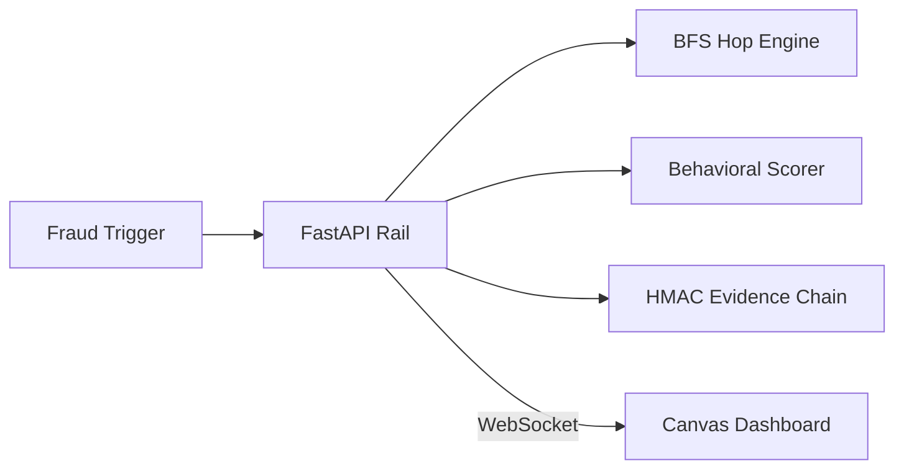

# TraceFlux — Real-Time Cross-Institution Fraud Tracing & Interdiction Rail

> **Scope note**: TraceFlux is a hackathon-grade prototype, not a production deployment. Data is synthetic, the graph is in-memory, and the "cryptographic evidence chain" is a local HMAC hash chain rather than a distributed ledger. The Design Decisions section below spells out exactly what's simulated for the demo and what a production rail would need instead.
>
> Live demo: [traceflux.vercel.app](https://traceflux.vercel.app/)

## The Problem
When a fraud report lands at a bank, the money has usually already fanned out across two or three intermediary "mule" accounts at other institutions before anyone reacts. Cross-institution fraud response today is largely manual and reactive — each bank can only see its own ledger, so tracing a stolen payment's downstream path requires phone calls and subpoenas while the funds keep moving. There's no shared, real-time layer that can (a) propagate a freeze signal across institutional boundaries the moment fraud is reported, and (b) flag mule-like accounts before they're ever reported.

## The Solution
TraceFlux simulates a central-switch-level interdiction layer (modeled on how NPCI/UPI sits between Indian banks) with two engines working together:

1. **Reactive Tag Propagation (`graph_engine.py`)** — on a fraud report, does a hop-by-hop BFS forward through the transaction graph, freezing every downstream account the money touched. Strict `tx.timestamp >= earliest_ts` filtering means a mule's unrelated past transactions are never falsely frozen — only money that moved after the fraud event.
2. **Proactive Anomaly Scoring (`ml_engine/anomaly_scorer.py`)** — continuously scores every account on 5 behavioral signals so high-risk mule accounts surface before a report ever comes in.

Every freeze produces a plain-English explanation and is appended to a tamper-evident, HMAC-signed hash chain, so each action is auditable after the fact.

## Architecture

The FastAPI rail sits at the center of every write: a fraud report fans out to the BFS engine (freezes the chain), the scorer (re-ranks account risk), and the evidence chain (logs the action), then pushes the result to the dashboard over WebSocket in real time.

## Key Results
- **Freezes a full 9-node fraud chain in real time**, measured by end-to-end propagation across the demo's 49-account synthetic graph, by running the BFS tag-propagation engine directly against the in-memory transaction graph rather than polling.
- **Every freeze is independently auditable**, measured by `GET /evidence_chain/verify` returning a pass/fail verdict on the full hash chain, by HMAC-signing each evidence entry and chaining it to the previous hash.
- **Zero false freezes on a mule's historical activity**, measured by strict timestamp-bounded BFS traversal, by filtering all propagation to `tx.timestamp >= earliest_ts` at the fraud report's origin.
- **System correctness is checked pre-demo**, measured by `backend/test_system.py` and `backend/validation.py` passing, by running both before every live run (see Quickstart).

## Design Decisions & Trade-offs

| Decision (prototype) | Why, for a demo | Production equivalent |
| :--- | :--- | :--- |
| **In-memory TransactionGraph** | Zero-dependency local setup, sub-millisecond BFS on a 49-node graph | Neo4j / Memgraph cluster, or a graph layer over a distributed store |
| **Single FastAPI process** | Simplest possible local run for judges | Kafka (or similar) event rail feeding stateless scoring workers, horizontally scaled |
| **In-process HMAC hash chain** | Demonstrates tamper-evidence without external infra | Append-only ledger (e.g. a permissioned blockchain or write-once log service) shared across institutions |
| **Synthetic data generator (`simulate.py`)** | No real transaction data needed to demo | Streaming ingestion from each institution's core banking system via a standardized event schema |
| **Single WebSocket hub** | Fine for one dashboard, one demo session | Pub/sub fan-out (Kafka/Redis Streams) to many concurrent institutional dashboards |

> This table exists specifically so the gap between "how this repo works" and "how a real interdiction rail would work" is explicit rather than implied.

## The 5 Risk Signals
`ml_engine/anomaly_scorer.py` scores every account continuously on:
- **`fan_out_ratio`** — how many distinct outbound counterparties an account pays relative to its inbound counterparties. Mule accounts tend to receive from one source and fan money out to many.
- **`velocity`** — transaction frequency over a rolling window. A sudden spike in transaction rate is a classic laundering tell.
- **`dormant_reactivation`** — how long an account sat inactive before a burst of activity. Mule accounts are often opened, left dormant to look legitimate, then activated once.
- **`structuring_score`** — how consistently transaction amounts sit just under reporting thresholds, a common structuring (smurfing) pattern.
- **`avg_hold_time_minutes`** — how long funds sit in the account before moving on. Mule accounts typically pass money through almost immediately.

Each account's `GET /accounts/{id}/explain` endpoint returns the weighted contribution of each signal, which `explainer.py` turns into the plain-English freeze reason shown in the dashboard.

## ⚡ Quickstart

### Recommended (Docker):
```bash
docker compose up --build
```
This boots the FastAPI backend and a production build of the React dashboard together — no dev-server flicker for live demos.
- **Dashboard**: http://localhost:5173
- **API docs**: http://localhost:8000/docs

### Manual (local dev):
```bash
# Backend
pip install -r backend/requirements.txt
python backend/test_system.py
python backend/validation.py
python backend/run_demo.py

# Frontend (separate terminal, for active development only)
cd frontend
npm install
npm run dev
```
> For a live demo in front of judges, use `docker compose up` or `npm run build && npm run preview` rather than `npm run dev` — the dev server is fine for iterating but not for a polished walkthrough.

## Component Architecture
```text
TraceFlux/
├── README.md
├── verify_live_stack.py          # In-process full stack integration check
├── docker-compose.yml            # One-command backend + production frontend
├── backend/
│   ├── requirements.txt
│   ├── graph_engine.py            # TransactionGraph BFS tag propagation engine
│   ├── dispatcher.py              # FreezeAlert dispatcher
│   ├── main.py                    # FastAPI server & WebSocket hub
│   ├── simulate.py                # Synthetic data generator (40 normal + 9-node fraud chain)
│   ├── security.py                # Tamper-evident evidence chain & HMAC signatures
│   ├── explainer.py               # Plain-English translation of ML feature contributions
│   ├── run_demo.py                # One-click launcher script
│   ├── test_system.py             # System verification test suite
│   ├── validation.py              # ML scoring validation script
│   └── ml_engine/
│       ├── __init__.py
│       └── anomaly_scorer.py      # Behavioral feature extraction & ML scoring
└── frontend/
    ├── index.html
    ├── package.json
    ├── vite.config.js
    ├── tailwind.config.js
    ├── postcss.config.cjs
    └── src/
        ├── App.jsx                # Root state, WebSocket lifecycle, view router
        ├── index.css              # Design tokens & all component styles
        ├── main.jsx
        └── components/
            ├── Sidebar.jsx
            ├── Header.jsx
            ├── StatsBar.jsx
            ├── NetworkGraph.jsx    # Canvas force-directed physics graph
            ├── RiskPanel.jsx       # Account list + ML risk inspector & explainability
            ├── AlertFeed.jsx       # WebSocket live alert stream
            ├── WatchlistView.jsx
            ├── AssetsView.jsx
            ├── EvidenceView.jsx
            ├── SettingsView.jsx
            └── SupportView.jsx
```

## API Endpoints
| Endpoint | Description |
| :--- | :--- |
| `POST /report_fraud/{account_id}` | Triggers BFS tag propagation, auto-freezes the downstream chain, returns the frozen chain JSON, dispatches alerts. Handles non-existent IDs with HTTP 404; idempotent on duplicate reports. |
| `GET /accounts` | Returns all accounts with dynamically computed risk scores. |
| `GET /accounts/{id}/explain` | Returns the feature-weight breakdown behind an account's risk score. |
| `POST /reset` | Restores a clean initial graph state between demo runs. |
| `GET /evidence_chain` | Returns the full tamper-evident hash chain of all freezes. |
| `GET /evidence_chain/verify` | Validates the chain's integrity and returns a verification verdict. |
| `WS /ws` | Pushes real-time `TAG_PROPAGATED`, `ACCOUNT_FROZEN`, and `DEMO_RESET` events. |

## Roadmap
- [x] Synthetic graph size slider in the dashboard header (49-node demo ↔ 500+-node stress graph) to show canvas performance under load.
- [ ] Swap the local hash chain for a real append-only log service.
- [ ] Multi-institution simulation (separate account namespaces per "bank").

## Security
This is a prototype: HMAC keys, synthetic account data, and the evidence chain are for demonstration only and are not suitable for production use as-is. See [SECURITY.md](SECURITY.md) for what's simulated versus what a production deployment would require (key management, real auth on the API, TLS on the WebSocket hub).

## License
Licensed under the [MIT License](LICENSE).
